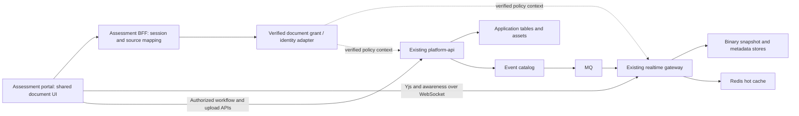

# Integrate the existing document workspace

Research checkpoint: September 20, 2026. This answers the user's correction that
the document experience already exists in realtime-examples, realtime-modules,
and ui-components. The reference is
`http://localhost:15174/documents/b66ba94c-3a52-4fe9-a37a-6ff10d91b069?type=custom`;
the destination is the assessment workspace at `localhost:5183`.

**Use the accelerator as the workspace UX reference. Use the existing `CanvasDocumentView`, `useCanvasDocument`, and gateway document
services. Move the example's reusable orchestration into their owning packages,
then consume it here.** Another layout pass, a new toolbar, or a replacement rich
editor would not satisfy this request. The previously shipped explorer layout
is useful surrounding structure, but it does not integrate this editor.

The paper canvas is reusable now. An isolated browser probe mounted the installed
shared component in this portal's dependency environment, imported Markdown into
a local Y.Doc, and edited it successfully. The complete example page is not yet a
drop-in library export: its current header, canvas extension assembly, uploads,
and workflow hooks include application-local code. Persistence and assessment
authorization also need explicit integration.

## Follow-up: fix the closest implementation

The user asked to repair the working shared editor rather than stop at research.
The closest implementation is the realtime canvas. The accelerator's
`ui/src/components/knowledge/DocView.tsx` edits Markdown in a textarea and renders
with react-markdown/remark-gfm; its Confluence conversion and reader preserve
GFM tables and `attachment:` image references. Those are useful compatibility
cases, not a replacement for the existing realtime editor.

**Fixed and pushed in realtime-modules 0.69.4, `37e70c945678d77534c1b0863a1a5a3cca5d730b`:**

- `docModelToPm` accepts the live schema. Canvas import and Markdown paste pass
  it, producing native table/image nodes when those extensions are present.
- Markdown export reconstructs tables and images, retaining image URLs, alt text
  and titles. Regression cases include the accelerator's attachment references,
  protected upload paths, formatted cells, alignment, nested lists, headerless
  tables and both block/inline image schemas.
- Schemas without the extensions keep source Markdown visibly and report the
  unsupported form. Linked images also retain both URLs as visible Markdown,
  because the current Yjs bridge loses marks on image atoms. This avoids hiding
  the destination URL loss behind a passing JSON-only test.
- Real-schema checks, binary restore and the actual canvas import hook are covered.
  All 1,355 upstream tests, build and 29 export checks pass.

[Fixed converter evidence](research-evidence/document-canvas-fixed-2026-09-20.json).
The initial evidence below intentionally records the old behavior. Fonts and
merged-cell layout still require canonical binary Yjs storage; ordinary GFM
preservation does not make Markdown a lossless rich-document format.

Consumer adoption is pushed in realtime-examples `b0845a47` (gateway and frontend)
and included in this assessment change (middleware and portal). Existing example
UI and work-graph edits were preserved; only the dependency changes were staged.
Both installed frontend dependency graphs passed the browser canvas probe:
[assessment result](research-evidence/document-canvas-consumer-browser-fixed-2026-09-20.json),
[assessment screenshot](research-evidence/document-canvas-consumer-browser-fixed-2026-09-20.png),
[example result](research-evidence/document-canvas-examples-browser-fixed-2026-09-20.json),
[example screenshot](research-evidence/document-canvas-examples-browser-fixed-2026-09-20.png).

Validation: 923 portal tests and its production build pass; example frontend
TypeScript build checking, gateway build and 548 document tests pass. The browser
proof verifies native tables/images, ordinary editing, Markdown table paste and
export with zero page errors and zero backend writes. It is still an isolated
component proof, not a claim the assessment workspace route now matches the UX.

The assessment middleware typecheck passes. Its full suite completes with 4,299
passing tests and three failures: route/write snapshots omit six internal compute
capability routes (already recorded before this change), and a promotion fixture
test assumes its re-promoted row sorts first despite later seeded timestamps.
The portal was restarted with dependency reoptimization; the exact assessment
workspace URL renders Rubric Overview without browser errors in a fresh session.
No middleware business logic changed in this patch. These failures remain open;
the whole repository is not claimed green.

## Evidence and limits

This research inspected source and installed package exports, opened the exact
reference URL in a fresh Playwright context, observed its REST/WebSocket traffic,
and ran conversion, binary restore, and browser composition probes. No edits were
made to the reference document. The follow-up changes shared conversion code and consumer dependencies; no
production page layout changes, cloud deployments, or shared container restarts
were made in this pass.

| Check | Observed result | Evidence |
| --- | --- | --- |
| Installed portal canvas composition | Existing paper canvas, toolbar, ruler, page/word status, zoom; local editing works; no page errors or backend writes | [Browser result](research-evidence/document-canvas-browser-2026-09-20.json), [screenshot](research-evidence/document-canvas-browser-2026-09-20.png) |
| Portal Markdown conversion | Headings, bold, lists, tasks, links and JSON fence survive these samples; table becomes a code block; image URL is lost | [Portal probe](research-evidence/document-canvas-portal-2026-09-20.json) |
| Example's newer installed conversion | Same table/image degradation even though table/image extensions are installed | [Example probe](research-evidence/document-canvas-examples-2026-09-20.json) |
| Rich binary snapshot round trip | Font family/size/color, underline, alignment, image and table survive Yjs encode/apply; normalized document JSON is equal | Same example probe, `binaryProof` |
| Markdown projection of that rich document | Reduces to text; rich marks and image/table structure do not survive | Same example probe, `markdownProjection` |
| Reference application | Full editor and existing document text render; comments/lifecycle/reviews/items load; CRDT subscription/snapshot observed | Live read-only browser inspection; source map below |

The local canvas proof is not a server persistence, collaboration, authorization,
or production deployment test. Earlier Docker durability/authentication results
are recorded separately in the [middleware deployment research](realtime-middleware-deployment-research-2026-09-20.md).
They were not rerun for this report. In particular, service authentication does
not establish end-user document permissions.

Reproduce from this repository after installing its locked portal dependencies:

```sh
node scripts/research/document-canvas-probe.cjs
node scripts/research/document-canvas-probe.cjs --examples
node scripts/research/document-canvas-probe.cjs --upstream
CANVAS_PROBE_SCREENSHOT=/tmp/document-canvas.png node scripts/research/document-canvas-browser-probe.cjs
node scripts/research/document-canvas-browser-probe.cjs --examples
```

The second command also requires the sibling example's installed frontend
dependencies. The browser command creates and removes an isolated temporary Vite
project. It uses synthetic content and an in-memory Y.Doc; it does not connect to
the gateway. The converter script reports behavior rather than asserting that
the present lossy conversions are acceptable.

## Where the experience already lives

Paths below are relative to the named repository. Sibling working trees and
installed packages can differ; use the recorded revisions and actual exports.

| Capability | Existing owner and file | Integration work |
| --- | --- | --- |
| Paper canvas, toolbar, ruler, outline, find, gutter, pagination, zoom/status | ui-components `src/components/doc-editor/CanvasDocumentView.tsx`, exported from `/doc-editor` | Consume directly; do not recreate |
| TipTap editor, collaborative binding, task lists, history configuration | ui-components `src/components/doc-editor/TiptapEditor.tsx` | Keep its existing collaboration setup; supply the same extra schema extensions as the example |
| Canvas body and schema migration | realtime-modules `src/client/useCanvasDocument.ts` | Use `body` Y.XmlFragment and `meta.schemaVersion`; import once under migration authority |
| Existing React integration wrapper | ui-components `src/integrations/realtime-modules/WrappedCanvasDocument.tsx` | Extend this existing seam where necessary; it already binds materialization and unsupported-content reporting |
| Document connection and reconnect | realtime-modules `src/client/useYjsDoc.ts`, `GatewayProvider.ts` | Supply verified identity and canonical document ID; maintain one Y.Doc lifecycle |
| Complete example composition | realtime-examples `frontend/src/components/doc-editor/DocumentEditorPage.tsx` | Separate reusable composition from application routing and transports |
| Canvas extensions, comments/suggestions gutter, uploads | realtime-examples `frontend/src/components/doc-editor/canvas/CanvasDocumentPane.tsx` | Extract reusable assembly into existing package boundaries; inject transport/upload/auth callbacks |
| Current ownership/lifecycle/mode header | realtime-examples `frontend/src/components/doc-editor/DocumentHeader.tsx` | Reconcile this fork with the existing shared DocumentHeader and migrate both consumers |
| Share/ownership/mode UI | ui-components `/doc-editor` exports including DocumentShareDialog, DocumentOwnership, DocumentModePill | Bind real access decisions; the dialog is not a permission store |
| Documents domain and creation/seed orchestration | realtime-examples `frontend/src/providers/DocumentsDomainProvider.tsx`, `components/doc-editor/migration/CanvasSeedHost.tsx`, local `useDocuments` | Retain one document authority and stable creation identifiers |
| Comments, replies, resolution, reviews, lifecycle, personal items | platform-api routes/repositories plus example `frontend/src/hooks/useDocumentComments.ts`, `useDocumentReviews.ts`, `useDocumentLifecycle.ts`, `useDocumentItems.ts` | Reuse REST backend; make reusable client bindings configurable instead of copying the backend |
| Document change notifications | realtime-modules DocumentEventsService; platform-api catalog publication | Subscribe and refetch durable records; subscription service is not a database |
| Protected images | example `frontend/src/hooks/useDocumentImageUpload.ts`, `components/doc-editor/canvas/AuthedImage.tsx` | Extract the existing authenticated upload/render adapter; store stable asset URLs, never bearer tokens |
| Durable content and metadata | example `src/realtime-fanout/crdt/adapters/DdbSnapshotStore.ts`, DdbMetadataStore, RedisHotCache | Reuse adapters and ownership admission; configure actual durable storage |
| Containers and table/CDK definitions | example `examples/middleware-foundation/compose.yml`, `lib/application-tables.ts`, `lib/message-queue-task.ts` | Compose these with platform-api/gateway/catalog services; do not create a second middleware stack from scratch |

The shared library also exports a `DocumentEditorPage` and `DocumentHeader` with
older contracts. Their names alone do not imply equivalence to the screenshot.
The running example imports its local page/header and its local CanvasDocumentPane,
which in turn imports the shared canvas. Importing the older page wholesale would
lose current example behavior and hide the actual integration work.

The canvas pane's extension assembly includes the realtime adapters MacroNode,
HeadingAnchor, MarkdownClipboard, Callout and CanvasTextAlign, plus TextStyleKit,
TableKit with resizing, authenticated images, and comment/suggestion extensions.
This assembly should have one reusable definition. Independent arrays in two
applications would let document schemas diverge.

The example carefully unmounts legacy section editors before materializing the
canvas. Preserve that transition when extending the existing wrapper. Running
both editors as writers during conversion is not a safe migration strategy.

## Preserve the accelerator UX

The user's instruction is to retain its good UX, not invent a different workspace.
The behavioral reference is the accelerator's `docs/knowledge-library.md`,
`DocumentsExplorer.tsx`, `KnowledgeTree.tsx`, `DocView.tsx` and Confluence `PageView.tsx`.
Reimplement the bindings using the existing shared components; do not copy its
handwritten HTML/CSS or discard its interaction model.

| Source behavior to retain | Integration requirement |
| --- | --- |
| Clear space header with source badge and count | Shared rail header must communicate the same hierarchy |
| Space-level Pull and New page | Actions stay with their scope; a new-page modal preselects the parent |
| Hover row actions: Add child and Pull | Reuse shared trailing/menu slots; avoid permanent buttons on every row |
| Drag before/after/inside | Preserve remote ordering/reparenting and optimistic feedback, detailed below |
| Page-level Edit, View raw, Pull and open-source/workspace action | Bind actual source actions, not placeholder menu entries |
| Local draft → changeset → explicit Publish | Editing a source mirror is distinct from publishing to Confluence; preserve raw/source fences and review before publishing |
| All comments and Activity as section views | Keep view scope and counts consistent with the selected space |
| Static comments sidebar with replies/context/status | Reuse shared thread UI and real threaded records; do not replace it with unrelated global presence chrome |
| No AI suggestions in navigation chrome | Keep navigation focused on documents and their source actions |

The earlier assumption that every synced page should remain read-only was too
restrictive for source parity. The current assessment app does enforce that rule,
but the accelerator has a safe local-draft and explicit-publish workflow. Port
that workflow deliberately; do not equate making a draft editable with silently
writing to the remote source. Prompts can retain their existing read-only policy.

## Navigator drag-and-drop parity

The accelerator already implements the behavior the user called out:
`ui/src/components/knowledge/DocumentsExplorer.tsx` wires its tree to `movePage`,
optimistically reorders/reparents the cached tree, rolls back on failure, and
reports pending/success/error status. It cancels a stale status timer before the
next move and avoids focus refetch interrupting a drag.

Its backend is `sdlcd/workflows/confluence_sync/api/move.py`, using the existing
Confluence client: reparent with append, then move before/after the appropriate
sibling and rebuild the source tree. A failed tree refresh after a successful
remote move is reported separately; treating it as a failed move would incorrectly
roll back the UI. Source comments contain differing historical live-verification
notes; this research did not mutate a live Confluence instance.

The current assessment `KnowledgeExplorer.tsx` already uses the shared TreeView's
`onReorder`, backed by `/api/assessment/knowledge/doc/move`, but **only for local
sections**. `moveKnowledgeNode` explicitly rejects synced sections. The screenshot
shows a synced section, so the user's missing drag behavior is real. Do not claim
local-only reordering matches the original workspace.

Reuse the existing shared tree and port the source-backed move semantics into the
assessment's source adapter. Preserve capability checks, cycle/descendant refusal,
parent validation, stable IDs and before/after ordering. Do not merely enable the
handler while leaving its backend guaranteed to reject, or reorder a mirror only
for the next pull to undo it. Acceptance must cover upward/downward moves, first/
last sibling, reparenting, persistence after reload/source refresh, rollback on
remote failure, and successful move followed by refresh failure. For local
upstream documents, use the existing document metadata hierarchy service.

## Dependency and bundling findings

The table records the initial inspection. The follow-up pins both assessment
portal and middleware to 0.69.4 at `37e70c945678d77534c1b0863a1a5a3cca5d730b`,
and adds the portal image/table/text-style peers at 3.31.3.

| Checkout / consumer | Observed revision or installed version |
| --- | --- |
| aws-agentcore baseline | `09bd388c` |
| Portal ui-components pin | `3b0a7e57fcb91a107b1aeeaa6087b76523c75e55`, 2.330.0 |
| ui-components checkout | `42547e0f`, 2.330.0 |
| Portal and middleware realtime-modules pin | canonical repo `08771183e29b6a560912a66328879c9e442518be`, 0.51.0, installed under the existing slalom alias |
| realtime-modules checkout | `c89571e`, 0.69.3 |
| realtime-examples checkout | `138117a0`; includes local uncommitted frontend changes |
| Example frontend installed realtime-modules | 0.69.0; root gateway pin is newer, 0.69.3 |
| platform-api checkout | `c74ffcd`; realtime-modules pin is the 0.69.0 line |
| distributed-core / service-runtime / managed-nosql-store checkouts | `ad0cec61` / `7a0e338` / `48bf834` |

The example frontend's package manifests and WorkGraphPanel/WorkGraphView already
had uncommitted work. This research preserved all four files. A reproducible
release must use exact committed dependencies, not accidentally incorporate those
working-tree changes. Use full git SHAs and verify installed exports after a pin
bump; version strings alone are insufficient.

TipTap is already installed in the portal (3.31.3); the old statement that the
editor is blocked on a general TipTap install is obsolete. The portal initially lacked
the text-style, table and image extension packages present in the example. The
follow-up adds those peers to consume the shared schema.

The first isolated browser composition failed with a duplicate ProseMirror
instance error. Adapting the existing example's `frontend/vite.config.ts` fixed
it: deduplicate React/Yjs dependencies, keep required realtime CommonJS entry
points in dependency optimization, and exclude the relevant ProseMirror/TipTap
modules from conflicting optimization. Excluding all CommonJS realtime modules
instead can introduce dynamic-require errors. The checked-in browser probe
contains the configuration that actually passed in this portal environment.

## Content authority and migration

The assessment pane currently edits Markdown through BFF GET/PUT, with a simple
CRDT `Y.Text('content')` integration. The canvas uses `Y.XmlFragment('body')` and
`meta.schemaVersion >= 2`. Those are different document formats. A component swap
cannot turn one into the other.

1. Add a durable mapping from `(tenant, source namespace, source ID)` to an opaque
   upstream document UUID. Preserve assessment URLs such as `page:100002` at the
   application boundary. `useYjsDoc` uses `doc:<documentId>` and CRDTService currently
   limits channel names to 50 characters; `doc:` plus a UUID fits, arbitrary source
   paths or tenant prefixes may not.
2. Record content authority, source revision, schema version and migration state
   with that mapping. For synced Confluence pages, keep remote source authority and a distinct
   local draft/changeset that is published explicitly. Keep prompts read-only. For locally editable documents, establish the gateway's
   Yjs state as the content authority after migration.
3. Fix/import-test the shared codec before bulk migration. The inspected baseline `docModelToPm`
   explicitly degraded tables and stripped image URLs. The 0.69.4 follow-up above
   fixes ordinary GFM conversion using the live schema; consumer adoption and
   the real assessment corpus still need verification. Unsupported constructs need explicit preserved
   representations or a blocked conversion, not silent data loss.
4. Seed once with the live editor schema, under server-coordinated migration
   authority. `useCanvasDocument.importMarkdown` is a seed/conversion operation;
   it rejects a nonempty body and is not a recurring replacement-save API. A
   browser's empty-state check alone does not coordinate two simultaneous seeds.
5. Persist binary Yjs snapshots/updates. Generate Markdown as a derived export or
   search projection. Do not rebuild Yjs documents from that lossy projection on
   reconnect, and do not leave BFF PUT and gateway editing as concurrent writers.
6. Migrate document title/metadata deliberately: the canvas helper's title and
   frontmatter handling does not automatically implement the assessment's rename
   contract. Preserve source IDs, version lineage and existing links.

The binary probe substantiates step 5: rich attributes and nodes survived encoded
Yjs restore while the Markdown projection lost them. This agrees with TipTap's
guidance that Yjs state must be stored as binary and JSON is a secondary view,
not a reconstruction source. [TipTap persistence guidance](https://tiptap.dev/docs/hocuspocus/guides/persistence),
[Yjs document updates](https://docs.yjs.dev/api/document-updates).
This is a storage-contract reference, not a proposal to replace the existing
gateway with Hocuspocus or a hosted editor service.

The user's exact assessment document is a synced Confluence page. Initially it
can use the shared reader, but source UX parity includes editing a local draft
and explicitly publishing a reviewed changeset. Prove that distinction rather
than treating source pages as permanently read-only or silently publishing edits.

## Identity, permissions and honest save state

The assessment uses a signed BFF session; the example's REST hooks use bearer
identity and the gateway has its own authenticated connection context. These
must represent the same verified person and tenant. A gateway clientId is a
connection identifier, not persistent identity. The retired arbitrary
service-signing gateway proxy must stay retired.

Recommended integration contract: exchange an authenticated BFF session for a
short-lived, audience-bound document grant that the upstream verifies. Bind
subject, tenant, document and allowed operations, with expiry and revocation or
session-epoch behavior. Alternatively use a common verified identity provider
token where its claims and audience meet both systems' requirements. The exact
mechanism remains an implementation decision; service HMAC authenticates services
and cannot substitute for end-user authorization.

Source inspection found concrete work before production acceptance:

| Finding | Required owning-layer change |
| --- | --- |
| Example `documentAccess.ts` returns owner when `createdBy` matches, otherwise editor | Bind server-authoritative roles; an ownership badge/share dialog is not an ACL implementation |
| CRDTService's injectable authz hook receives client/channel/service, without a read/write operation argument, and defaults permissive | Extend the existing policy contract with operation context; enforce subscribe, update, save, restore and metadata/list operations, including after asynchronous admission |
| Example organization-prefix checks do not by themselves scope normal `doc:<UUID>` channels | Resolve each document to its tenant and authorize the requested operation; test cross-tenant IDs and revoked access |
| platform-api comments route uses requireAuth, but the inspected route/mount does not establish document-specific access | Apply common document policy to comments/reviews/lifecycle/items/uploads, not only the editor socket |
| Comments GET with `sectionId` calls `getCommentsForSection(sectionId, limit)` without binding `documentId` | Scope the repository lookup to the authorized document/tenant and add a mismatched-document regression |
| Example DocumentHeader renders “Auto-saved” whenever mode is editor | Bind shared header status to an actual save contract |
| GatewayProvider's synced state indicates an initial snapshot, not a durability receipt for each edit | Define persisted revision/update acknowledgement, pending/failed state and retry behavior before claiming saved |

These are source-level findings, not an attempted cross-user exploit or a claim
that every deployment configuration was audited. The default development fixture
identity and SKIP_AUTH mode are not production identity integration.

Reuse the existing SnapshotManager/save acknowledgement path where possible.
Extend it if needed to distinguish local changes, gateway acceptance and durable
commit. A connection indicator or successful initial snapshot cannot establish
that a later edit survived a process failure. The shared header should expose
clear pending, saved and failed states driven by that contract.

## Comments, workflow and reference-page service dependencies

The live reference loaded comments, lifecycle, reviews, macro-section items,
personal reviews/items, document types and rooms from platform-api (`:13001` in
this development configuration). Chat conversations, presence and active calls
came from the gateway (`:18080`). WebSocket frames included CRDT subscription and
snapshot, document list/presence, document events subscription and awareness.
These ports are local wiring, not deployment API contracts.

Preserve the assessment's existing durable comments and per-actor reactions during
integration. The platform comment create contract expects a section, anchor or
parent; current assessment document-wide comments do not necessarily have one.
Add explicit document-level scope upstream or retain a clearly bound legacy
thread during migration. Do not invent text anchors or discard old IDs, authors,
timestamps, replies or reaction ownership.

Use existing relative-position comment machinery for new anchored comments.
Yjs relative positions survive concurrent edits, but deleted content can make an
anchor unresolved; the UI needs an orphaned-thread state and restore tests.
[Yjs relative-position contract](https://docs.yjs.dev/api/relative-positions).

Keep lifecycle transitions server-owned, using availableActions and version/CAS
from the existing API. Conversation sharing and granting document access are
different operations in the example; connect each button to its actual contract.
Use the existing upload flow and authenticated image renderer; bearer credentials
must not be written into document content or exported image URLs.

DocumentEventsService delivers notifications rather than storing comments or
workflow data. Some platform routes publish signals after persistence; not every
signal has durable outbox semantics. Reconnect must refetch authoritative REST
state rather than assume every notification was delivered exactly once.

## Runtime and deployment composition



The exact network ingress/BFF forwarding topology can be selected during
implementation. The ownership boundaries above should remain stable.

| Layer | Reuse / deploy | What is still required |
| --- | --- | --- |
| Durable local database | managed-nosql-store and the existing foundation init job/table manifest | Persistent volumes, restart readiness and compatible table/index bootstrap |
| Hot cache | Existing Redis integration | Connectivity, bounded failure behavior; never sole content authority |
| Realtime content | Existing gateway + CRDTService + DdbSnapshotStore/DdbMetadataStore | Verified user policy, image/config pins, readiness, graceful drain, durable save status |
| Document workflows | Existing platform-api | Same identity/document scope, complete table manifest, uploads/assets configuration |
| Events | Existing catalog and message-queue services | Production service credentials, private ingress, recovery/refetch contract |
| AWS composition | Existing ApplicationTables and MessageQueueTask constructs; root MiddlewareService stack | Add actual gateway/API/catalog/cache service composition, IAM/secrets, TLS/WS routing and networking |
| Calls/media | Existing SFU/TURN/signaling when selected | Optional for document editing; do not make basic canvas acceptance depend on deploying calls |

MQ is not the per-keystroke CRDT transport; that traffic already uses WebSockets.
Do not introduce another DC consensus/coordination primitive simply to mount the
editor. Reuse the existing middleware-foundation Compose application profile and
its ownership/storage adapters.

The foundation's application dev profile still uses development user auth.
Previously passing production MQ/catalog service-auth gates do not make that
entire profile production-ready. The root CDK middleware service deploys the
assessment Express BFF; an external gateway URL parameter does not deploy the
gateway or platform-api.

Existing ownership admission now refuses unknown/remote ownership, but that is
not storage fencing or a complete multi-node forwarding implementation. Preserve
the documented single-writer/stop-before-start constraint until transfer and
fencing are proved. Do not turn on overlapping replicas and claim high availability.

ALB supports native WebSocket upgrades, but health checks use HTTP/HTTPS rather
than WebSocket probes. Use distinct application readiness and authenticated
protocol acceptance tests; health alone is not access control, including ALB's
all-targets-unhealthy fail-open behavior.
[AWS listener documentation](https://docs.aws.amazon.com/elasticloadbalancing/latest/application/load-balancer-listeners.html),
[AWS target health checks](https://docs.aws.amazon.com/elasticloadbalancing/latest/application/target-group-health-checks.html).

## Implementation sequence and acceptance gates

Each step changes the owning repository first and then verifies both consumers.
Use exact package commits with built exports; preserve unrelated working-tree
changes. This sequence is an integration plan, not a claim these changes shipped.

| Step | Owner and concrete change | Exit evidence |
| --- | --- | --- |
| 1. Consolidate reusable composition | ui-components: modernize its existing DocumentHeader/wrapper from the example fork. realtime-modules: centralize schema/adapter behavior and configurable document client bindings. examples: consume those exports | Reference editor still has paper/ruler/toolbar/zoom, ownership/mode/actions and working workflows without a second header/schema implementation |
| 2. Make content migration safe | realtime-modules adapters: table/image preservation and unsupported-content behavior; aws-agentcore: durable UUID/source mapping and migration state | Fixture conversions retain URLs/nodes; concurrent first opens seed once; binary restore preserves rich schema; old source revision remains recoverable |
| 3. Establish authorization across transports | realtime-modules/examples: operation-aware policy; platform-api: scoped document routes/repository queries; aws-agentcore: verified session-to-document identity mapping | Two-user and cross-tenant tests deny read/update/restore/share/comment/upload as appropriate; revocation after connection takes effect; forged client identity fails |
| 4. Deliver one durable assessment document | Portal DocPane consumes shared canvas/header and upstream client bindings; backend content authority switches for one editable local document | Two browser sessions see edits; reload and gateway restart retain rich content; failure does not display saved; exact synced reference page renders correctly, with draft/publish actions gated by their implemented source contract |
| 5. Integrate document workflows | Reuse comments/replies/reactions, reviews, lifecycle, uploads, versions and personal-item UI/services | Existing assessment records preserved; new anchors track edits; orphan/restore behavior explicit; workflow CAS conflicts handled; protected images reload |
| 6. Package the complete application stack | examples Compose + reusable CDK constructs; root infrastructure consumes them | Clean locked images boot from empty storage, become ready, survive replacement and authenticate every hop; synth assertions cover actual services/secrets/IAM; deployment only after reviewed configuration |

Steps 1–3 can be developed incrementally, but the first user-facing completion
gate is step 4: the real shared editor in the assessment route with verified
durability and permissions. Another polished local-only preview is not that gate.

Required acceptance coverage includes production Vite build as well as dev mode;
duplicate TipTap/ProseMirror/Yjs detection; two simultaneous writers; reconnect
without duplicate seeding; cold gateway restart; binary version restore; offline
and failed-save status; source draft/publish separation and read-only prompt enforcement; comment/reaction
identity; denied cross-document section lookup; and schema compatibility across
pinned client/server versions. Exercise the Docker profile with real application
services rather than replacing all dependencies with mocks.

The team certification page in the earlier screenshot remains a separate
assessment composition task. Reusing its document/side-panel primitives may help,
but a document editor integration does not by itself redesign scoring and evidence
navigation. Do not claim that page complete from this research.

## Remaining decisions and scope boundaries

- Select and implement the verified identity/grant contract and common document
  policy; there is not yet an end-to-end production proof of assessment identity
  through both upstream transports.
- Decide an explicit canonical title/metadata mapping, source refresh behavior,
  and schema-version compatibility policy. Do not infer editing permission from
  the example's owner-or-editor fallback.
- Define the persisted acknowledgement contract, and test crash timing around it.
  Initial sync and visible local content are insufficient evidence.
- Complete preservation tests for real assessment Markdown, macros and comments,
  beyond the six synthetic conversion samples here.
- Prove full application container restart and workflow acceptance after the
  consumer integration; the isolated browser and earlier foundation gates cover
  different boundaries.

The research establishes a concrete reuse path and reproduces the main technical
gaps. It does not establish that the assessment UI already matches the reference,
that workflow permissions are complete, or that the full AWS stack is deployed.
