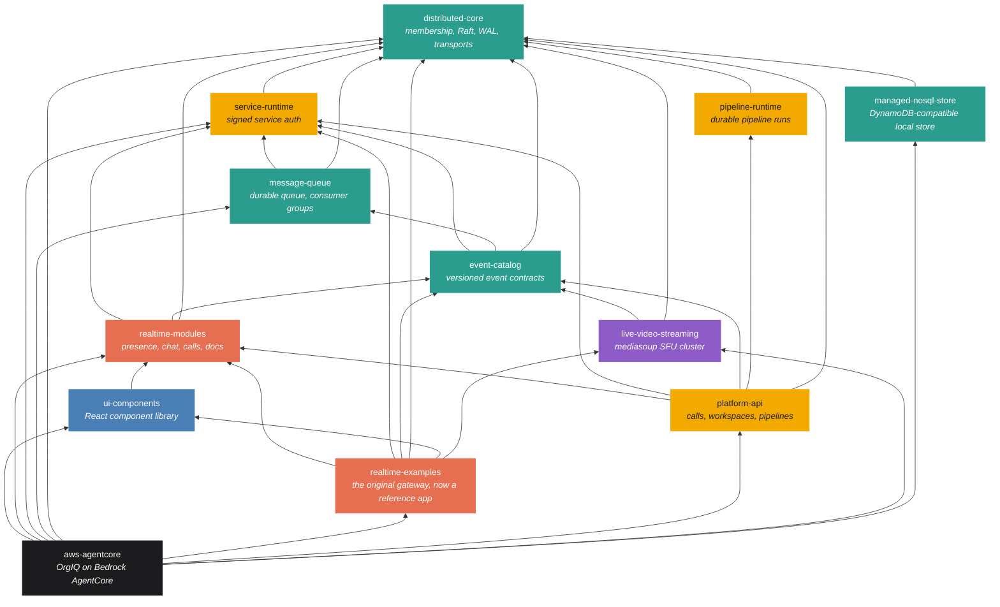

# How these projects came to be

This is the story behind the twelve repositories that make up this platform, told in the order I built them. Every one of them started as a question I wanted to answer. The dates come from the git history; the reasons come from memory.

## 1. A WebSocket gateway on AWS (June 2025)

I started with a project called websocket-gateway. I wanted to build real-time communication on AWS: presence tracking, cursor tracking, that kind of thing. It was a Node WebSocket server with Redis pub/sub so several instances behaved as one, deployed with CDK behind a load balancer. By July it had a small SDK and a multi-mode cursor demo.

That repository is still alive. It was renamed realtime-examples and it sits at the top of the dependency tree today as the reference app.

## 2. How does Google Docs work? (March 2026)

The next thing I wanted to know was how Google Docs actually works. That took me to Yjs and CRDTs, then to ProseMirror and Tiptap for structured rich text, and to drawing presence over the canvas instead of next to it. I just kept going from there.

The first commit mentioning CRDTs is from 2 March 2026, the day the restart began (see section 4). Collaborative documents, cursors and presence are now hooks in realtime-modules, with document workspaces and grants in platform-api and the editor UI in ui-components.

## 3. Amazon IVS, then mediasoup (April 2026)

While studying for an AWS certification I came across Amazon IVS for video streaming. I looked at it, then got curious about how it actually works underneath. I found the tools the community uses for that, mediasoup in particular, and built my own.

The first version of video calling in the document editor used IVS Stages (14 April 2026). Two days later the commit titled "Local IVS replacement" swapped in a multi-worker mediasoup SFU with stages, rooms and channels. That became live-video-streaming: a full SFU cluster with WHIP and WHEP ingest, RTMP and HLS out, recording, TURN, Prometheus and Grafana, plus the lvs-client and lvs-react libraries the apps use to join a call.

## 4. The agents got good (the gap, and the restart)

About a year earlier I had tried to get coding agents to do real work on these projects and they failed. Summer 2025 produced about a hundred commits across the gateway, a video server scaffold and a clustering scaffold, and then nothing for six months. There are no commits between late August 2025 and 1 March 2026.

Then the agents got good. From March 2026 I could hand them whole phases of work with written plans and they would finish them. Almost everything in this story after that point was built that way, with my subscription tokens as the budget.

## 5. What would a million users need? (July 2025, rebuilt April 2026)

I also went and read the papers behind the AWS services I was using: the Amazon SQS paper, the DynamoDB paper, and a pile of related material. Out of that came the idea for a library called distributed-core: the pieces you need for scalable systems in the cloud, the kind that could handle a million users. Membership and gossip for who is alive, Raft for the state that has to agree, write-ahead logs for the rest, quorum, admission and transports.

It was scaffolded in July 2025 and rebuilt properly in April 2026. Raft landed as version 0.6.0 on 28 April. Everything else in the tree stands on it.

## 6. message-queue, managed-nosql-store and event-catalog (May 2026)

With distributed-core in place I kept going. I wanted to know what it would take to build a queue, so I added message-queue, a durable queue with SQS semantics (visibility timeouts, batching), consumer groups and durable subscriptions. The DynamoDB paper became managed-nosql-store, a DynamoDB-compatible store so the same code runs locally and in AWS.

Then I needed somewhere I could visually see the contracts that messages adhere to, so other systems could connect to them. That is event-catalog: versioned event contracts with an admin UI.

## 7. The gateway, second time around (May 2026)

By May 2026 the original gateway had grown everything into it: chat, calls, documents, pipelines. So I cut it apart. In three weeks eight libraries were extracted: message-queue (4 May), managed-nosql-store (5 May), event-catalog, platform-api and ui-components (7 May), service-runtime and pipeline-runtime (13 May), and realtime-modules (21 May). That month has 4,833 commits across the repositories.

realtime-modules is essentially another version of the socket gateway, and it had some really dynamic stuff in it: channel authorization, presence, chat, reactions, notifications, calls, meeting rooms, collaborative documents, all as React hooks an app can mount in a line.

## 8. Agentic workflows and pipeline-runtime (April to May 2026)

Around then I got onto a project where I was heavy in Claude, and I wanted to push on that. I learned about agentic workflows and started working on pipeline features. The realisation was that I could run Claude Code headless and run a workflow over files with it.

That is also where I got exposure to durable pipelines on AWS, and I said: I already have a lot of these tools and all these sister components, why can't I just build it myself? So I did. pipeline-runtime is durable pipeline runs with a store, resume, approve and rerun. platform-api runs the agentic pipelines, lobby admission and document workspaces for the apps. service-runtime is the signed service-to-service authentication between all of these hops.

## 9. Bedrock AgentCore: OrgIQ (May 2026)

At that point I started looking into Amazon Bedrock AgentCore. A lot was coming out, so I started building on it: RAG, search agents, a knowledge graph. It sounded interesting at the time. I wouldn't invest the time in it now, but what came out of it was a set of experiences built on top of Bedrock and AgentCore: aws-agentcore, the OrgIQ platform. Eight agents, CDK infrastructure, a backend-for-frontend and a React portal.

So now I had two separate projects: this really dynamic socket gateway, and the AgentCore work.

## 10. Merging them: one BFF, many tenants (August 2026)

Over the summer I was on an Amazon ProServ project with a shared BFF and the bulkhead pattern AWS uses on engagements: multi-tenant, where each app had its own frontend and backend. I had all these different use cases of my own, a social video system, documents, agents, so I said: why don't I do the same thing, and share my library tools across them?

I drove forward with building a BFF on top of the AWS infrastructure I already had from the AgentCore work. The first thing was bringing in Cognito and Cedar policies to build a permission system, role-based and attribute-based. Eventually that worked (enterprise SSO through Cognito landed on 20 August 2026), and that is the front door of where I am now: five tenants, work, assessment, social, pipelines and access, sharing one backend.

## 11. Stop hand-rolling the UI: ui-components

Combining things made one problem obvious: shared UI components. You start a million projects and you build the UI from scratch each time, and you spend so much time on it when it is not the high-value part of a research project. So I created the ui-components library and kept driving my agentic sessions to refactor against it, with one rule: do not hand-roll any UI components. Eventually it got pretty strong.

I also worked on a standardised layout where a lot of content can be organised and managed like a stack: go deep into a content taxonomy and come back, using an accordion-style vertical layout from the top-level navigation down to a deeper context. I call them vertical stacked pane menus.

## 12. Proxy to Claude: the composer

Then it started to get a little crazy. With the Bedrock work I realised I did not want to be writing custom agents and Lambdas. What I really wanted was to proxy to Claude in the quickest way possible, which meant I needed a chat dialogue. The issue was that I had all these tenants: social, agents, work. So I came up with one dynamic component at the bottom of the page where I can switch context between writing a message, adding a comment to a feature, or running a skill. That is where the composer came from.

## 13. Where it stands (September to November 2026)

In the last two months a lot got stabilised, the video chats in particular. I added hangouts and meeting rooms, though they have not been tested much. It is not really a shared BFF any more, because the social tenant is embedded inside some of the other tenants; I cannot isolate them, and I would not want to. There may be a better architecture pattern for that which I have not been exposed to yet. There is a lot in there I have not had time to fine-tune.

## 14. Where it is going: manage work, not code

The goal is not to have testers or developers. I want to manage work at a project-ownership level and allocate budgets, where a budget is agent time plus compute time.

The compute is AWS microVMs. You build a Docker container with Claude in it and it starts up fast on Firecracker. I inject work into these VMs: one boots, clones the repository, starts Claude with a set of skills passed in as preloaded context based on the work activity, gets handed the feature to execute, does the work, commits it and opens a PR. That can easily expand to testing and to a pipeline that does the whole CI and CD side.

The other idea is bots: a cron-based system that is constantly scanning and looking at a project. Those are just skills, and each project can carry a budget to run them, especially once it is in an operational phase.

Then there is distillation. When I use Fable at the highest level of reasoning I see things I have never been exposed to, like the way it debugs Chrome sessions. So why not make those into skills? And the agents are constantly working in and learning about my codebase; why keep asking them to figure it out again? I am trying to come up with a distillation process where agents record their experiences and inventory them, and when an agent runs on a piece of work, the relevant skill is loaded in. I have not had time to test that yet.

Hangouts close the loop. You can start a hangout and look at a lot of work together. I have a recording system built, so when the hangout ends it pipes into a transcription process; you can watch the recording later, and from the transcript you could create more work items through the pipeline features.

Again, the idea is to manage work at a project level, take everything technical out of the way, and move quickly with a small team.

## The repositories

| Repository | What it is | First commit | Commits |
|---|---|---|---|
| realtime-examples | The original WebSocket gateway, now a reference app and CDK constructs | Jun 2025 | 4,060 |
| live-video-streaming | mediasoup SFU cluster with client libraries | Jul 2025 | 1,165 |
| distributed-core | Clustering toolkit: membership, Raft, WAL, transports | Jul 2025 | 1,464 |
| message-queue | Durable queue with SQS semantics and consumer groups | May 2026 | 453 |
| managed-nosql-store | DynamoDB-compatible store for local and test use | May 2026 | 369 |
| event-catalog | Versioned event contracts with an admin UI | May 2026 | 343 |
| platform-api | Calls, workspaces and agentic pipelines for the apps | May 2026 | 804 |
| ui-components | React component library and page templates | May 2026 | 1,647 |
| aws-agentcore | OrgIQ: multi-agent platform on Bedrock AgentCore | May 2026 | 1,559 |
| service-runtime | Signed service-to-service authentication | May 2026 | 112 |
| pipeline-runtime | Durable pipeline runs with resume and approval | May 2026 | 90 |
| realtime-modules | The gateway as a library: presence, chat, calls, documents | May 2026 | 449 |

Counts are as of 6 November 2026. Across all twelve: about 12,500 commits over seventeen months, with a six-month gap in the middle.

## The dependency tree

An arrow means "depends on". Read it bottom to top: distributed-core is the only leaf, and the two apps at the top consume almost everything.

The same diagram is in `docs/dependency-tree.svg`.

## Suggested deck order

1. Title
2. Every repository started as a question (12 repos, 12,500 commits, 17 months)
3. June 2025: the gateway, with the original demo
4. The arc, from the git log (timeline)
5. Commits per month
6. Question 1: how does Google Docs work?
7. Question 2: how does Amazon IVS work underneath?
8. Question 3: what would a million users need?
9. Question 4: what if the agent is part of the system?
10. May 2026, the split: eight libraries in three weeks, realtime-modules as the gateway rebuilt
11. Bedrock AgentCore and OrgIQ
12. One BFF, many tenants: the merge, Cognito and Cedar
13. Do not hand-roll the UI: the component library and the stacked-pane layout
14. Proxy to Claude: the composer
15. The dependency tree
16. Where it stands
17. Where it is going: budgets, microVMs, bots, distillation
18. Hangouts close the loop: recording, transcription, work items
19. The repositories
20. Close
