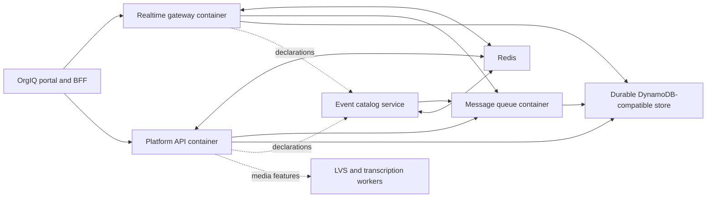

# Deploy the existing realtime middleware as a reusable stack

Research checkpoint: 2026-09-20 UTC / September 19 US Eastern. The operator
clarified that the priority is MQ, DC, realtime-modules, examples, and the
supporting Docker containers, with fixes made in the owning repositories.
Editor work is deferred. This document supersedes the deployment-choice section
of [the earlier document integration map](document-backend-integration-2026-09-19.md).

## Application bootstrap and document follow-up

The next wave is implemented upstream:

- **platform-api `1ee19a2`** uses the committed lockfile in both container
  stages and fails its build on TypeScript errors. The clean Linux image builds.
- **realtime-examples `f90bdf30`** does the same for the gateway's separate
  `src/package.json`/lockfile, declaring compile-time dependencies instead of
  installing an untracked second dependency graph. Strict container compilation
  now passes; the previous `--noCheck` bypass is removed.
- **realtime-examples `76d67cdd`** consolidates the 51-table shell bootstrap
  into the schema JSON and a bounded, schema-checking SDK initializer. The
  JSON had only 25 tables and several stale GSI definitions. Tilt's wrapper and
  Compose now share the initializer; existing keys/indexes are checked, missing
  GSIs added, and database errors propagate. No tables are deleted or replaced.
  The init job gates service startup with `service_completed_successfully`.
- The optional application profile starts the existing gateway and platform API.
  It initializes twice, creates a team with owner membership and General channel,
  replaces API/database, and reads the team/channel back. A WebSocket document
  create/update/named-save also survives gateway/database replacement after its
  Redis snapshot key is explicitly removed. This exercises the real library and
  deployment adapters, rather than alternate document code.
- **realtime-modules `58ac165` / 0.69.1** closes the reproduced direct-update
  channel-policy bypass and rejects failed snapshot writes. Snapshot commits
  serialize per channel, concurrent edits retain dirty state, and named saves
  return the actual stored version key. All 1,336 library tests passed; the full
  run retained handles after completion, while the eight added regressions
  exited cleanly with handle detection. Built exports and the original isolated
  probe verify the new behavior. Gateway adoption is verified in the application container gate (`f1eb248f`).

[Application container evidence](research-evidence/middleware-application-2026-09-20.json)
records the tested application images, including realtime-modules 0.69.1 adoption.
[Updated library probe](research-evidence/document-toolkit-fixed-2026-09-20.json)
records the policy/failed-save corrections. Seven initializer tests cover fresh
and repeated bootstrap, missing/wrong indexes, wrong primary key, denied access
and bounded outage. Production identity, ACLs, library collection/history policy,
cold-store read-error handling and reusable CDK composition are still pending.

**Operational follow-up:** MQ `160d0c0` now probes durable table availability
for readiness and drains through service-runtime on SIGTERM/SIGINT. Container
acceptance verifies readiness 503 while storage is down, liveness 200, readiness
recovery, successful shutdown hooks and accepted-message recovery after a
graceful restart. Its 40 focused tests passed. The full run passed 1,472 tests
and skipped 42; one HTTP quota test returned an unexpected 400, then its entire
11-test suite passed on rerun. This is not a claim of an all-green full run.

Examples `f1eb248f` pins the library in both gateway manifests and bounds the
shared DynamoDB client (two attempts, 1.5s connection/3s request deadlines).
A real socket-stall test verifies rejection, alongside seven factory tests.
The container gate additionally verifies failed named-save error propagation
and retrieval using the actual acknowledged version timestamp. An initial
outage probe tried to subscribe after the outage and never exercised Save;
it now subscribes first, then interrupts the store. The resulting test exposed
the unbounded client request, which is corrected in the factory.
The old default standalone MNS result remains valid. The foundation uses Raft.

## Durable foundation: verified follow-up

The ordinary queue persistence/acknowledgement milestone is now implemented
and tested across owning repositories. This supersedes the initial finding
that no MNS durable mode had been verified; default standalone mode still loses
items. No new queue, realtime service or UI was built.

| Owner | Shipped change | Commit |
| --- | --- | --- |
| managed-nosql-store | Start Raft before accessing its state machine; clean Linux dependency build; isolated durability gate | `48bf834` |
| distributed-core | Persist deletion before releasing queue lease; block expiry/removal races; recovered-pending removal | `18ebf5f4` / v0.46.0 |
| distributed-core | Repair published ESM shared-chunk loading and verify actual imports; guard retention race | `ad0cec61` / v0.46.1 |
| message-queue | Adopt v0.46.1, check completion failures, retain failed receipts, remove recovered bodies before acknowledging | `1f1ef3e` |
| realtime-examples | Isolated MNS + MQ + Redis Compose foundation, crash/outage acceptance script, runbook and image evidence | `bcf23613` |

**Root causes.** MNS's existing Raft path was usable after a startup-order fix:
its backup registry requested the state machine before `server.start()` had
created it. The default standalone path is a different store. MQ completed
in-memory leases before attempting durable deletion, caught storage errors,
and still returned success. Its restart receipt path removed only the receipt,
leaving the body to replay. Those are now corrected through DC's additive
persistence hook, rather than another queue implementation in an adopter.

Consumer installation also exposed a DC packaging defect hidden by source tests:
esbuild's shared `__require` helper had no lexical Node `require` binding.
The per-entrypoint shim did not fix imported chunks. v0.46.1 repairs the build
and makes `verify:dist` import the actual ESM root/queue exports in a fresh process.

**Container evidence.** Clean-built MNS passed acknowledged Put/Get across
SIGKILL, conditional-write rejection, conditional update across container
replacement, Query recovery and durable deletion. The examples gate then used
real MQ HTTP calls and DDB adapters: publish survived killing/replacing both
services; a receipt issued before MQ replacement deleted the recovered body;
acknowledged deletion survived a second replacement; killing the store made
acknowledgement return HTTP 500, and the same receipt succeeded after recovery.
All test resources were UUID-owned and removed; no host ports or external
network were used. Redis ran for fanout but its document-state recovery was not
tested. Exact image IDs are recorded in
[MNS evidence](research-evidence/mns-raft-durability-2026-09-20.json) and
[MQ/MNS evidence](research-evidence/mq-mns-foundation-2026-09-20.json).

Reproduce with the committed
[foundation runbook](https://github.com/connorhoehn/realtime-examples/blob/bcf23613/examples/middleware-foundation/README.md).
No registry image release or AWS deployment was performed.

**Validation limits.** DC's earlier full suite passed 9,595 tests (6 skipped);
the final queue regression suite passed 43 tests, and build/export/import checks
passed. MNS's Raft server suite passed 9 tests. MQ's 21 focused durability tests
and TypeScript/container builds passed. Its full run passed 1,467 tests, skipped
42, and failed two: one stale mock returned no completion result; one HTTP test
had a socket hang-up. After correcting the mock, both complete affected suites
passed all 46 tests. This records the rerun accurately rather than claiming a
single all-green full run.

**Still required before production composition:**

1. Application table/GSI initialization and clean gateway/platform-api builds:
   completed in the application follow-up above; retain these gates for releases.
2. Identity/service authentication, durable ACL bootstrap and remaining dependency-aware
   readiness/drain behavior (MQ now covered); this isolated profile intentionally disables auth.
3. Remaining queue semantics: restart hydration currently exposes pending bodies
   before old visibility timeouts expire; delayed/dedup/group paths include
   in-memory state. No multi-process message fencing has been established.
4. Realtime library policy and snapshot persistence seams described below.
5. CDK resource injection and assertions, followed by authenticated full-stack
   acceptance. Keep the existing gateway binary and adapters.

For CDK, **one desired MQ task is not enough**: rolling replacement can overlap
old/new tasks. Until ownership fencing exists, deployments must prevent overlap
and explicitly accept the stop-before-start availability cost. This conclusion
combines MQ's local ownership model with
[ECS deployment semantics](https://docs.aws.amazon.com/AmazonECS/latest/developerguide/deployment-type-ecs.html).
A single-voter store proves process recovery, not host power-loss tolerance or HA.

## Recommendation

Adopt the existing gateway, platform-api, MQ, event-catalog and supporting stores
as a versioned backend deployment. Keep DC, realtime-modules, service-runtime and
pipeline-runtime as libraries inside their consuming images. Repair the actual
container and service contracts upstream; aws-agentcore should supply its
identity/capability mapping and CDK composition, not duplicate those services.

Use a reproducible local deployment as the acceptance harness for a reusable CDK
construct. Accept existing VPC/cluster/auth/storage resources in that construct;
do not bootstrap a second identity system or copy the entire demo infrastructure
into this app. For AWS, DynamoDB is the most direct durable backend for the
existing adapters. Preserve an explicit self-hosted MNS deployment option, but
require restart/replacement persistence tests before presenting it as durable.
This is a recommendation, not a deployed or fully implemented architecture.



This is the target connection map, not a statement that every edge is currently
configured. The AWS AgentCore MCP Gateway is a different service from this
WebSocket gateway.

## What is already reusable

| Owner | Existing implementation to retain | Deployment responsibility |
| --- | --- | --- |
| distributed-core | Cluster/transport/routing/queue/persistence primitives | Package/version compatibility and reachable peer topology; no DC container |
| realtime-modules | Realtime services, client hooks, CRDT, presence, attach factories | Install built subpath exports; inject durable stores and policy |
| realtime-examples | Working service composition, DDB/Redis adapters, ownership wrappers | Gateway image, service configuration, integration examples |
| platform-api | Domain REST, document lifecycle/comments, outbox, pipeline bootstrap | API image, tables/GSIs, service credentials and workers |
| message-queue | HTTP queue service; DDB messages, leases, DLQ, metadata, offsets | Explicit store selection, table provisioning, auth, restart acceptance |
| event-catalog | Library publish path plus registry/observability server | Registry container, Redis, MQ URL; library publish is not a server RPC |
| service-runtime / pipeline-runtime | Auth/lifecycle helpers and pipeline bridge | Packages, not mandatory new services |
| managed-nosql-store | DDB-compatible service, standalone/cluster/storage options | Writable paths, durable mode, persistent volumes and recovery tests |
| live-video-streaming | SFU plus recording/transcription integration | Optional media deployment; UDP, storage and worker model need separate validation |

`platform-api/src/index.ts` currently wires the pipeline bridge and in-process
bootstrap. Do not infer a mandatory separate pipeline-worker container from an
old roadmap. Similarly, examples' old constitution says event-catalog is
library-only, but event-catalog's current CLI, Dockerfile and CLAUDE describe and
implement its server. The source and runtime checks take precedence.

## Evidence and fixes

| Finding | Evidence | Result of this pass |
| --- | --- | --- |
| Gateway Compose command targets a missing file | Existing gateway image has `/app/server.js`; `/app/src/server.js` is absent | Removed stale command/source mounts in both examples Compose files; use image default |
| Private dependency builds omit build auth | Dockerfiles require SSH mounts; LVS requires a GitHub token build secret | Added matching Compose build forwarding; no credentials committed |
| Event-catalog cannot reach intended MQ by default | Local MQ listens on 3002; registry otherwise defaults to localhost:3004 | Set service URL and health dependency; MQ schema URL also explicit |
| MQ database URL does not select DDB storage | `QueueStorageFactory` defaults to memory | Documented/explicit local mode; production contract must select `ddb` |
| Misspelled MQ storage mode silently loses durability | Every unrecognized mode returned memory | Upstream now rejects unknown values; unset/blank still retains compatible memory default |
| MNS default image cannot start as non-root | Disposable cached image exits EACCES creating `/app/data/backups` | Image defaults now point at writable `/var/lib/ddb`; rebuilt image starts |
| MNS health checks always fail | `GET /` and `/health` both return 404 | Image and examples local probe now exercise bounded `ListTables` |
| Successful MNS write does not survive default-mode restart | Isolated rebuilt image: Put/Get succeeds, restart, Get has no Item | Default mode remains volatile; follow-up verifies the separate single-voter Raft path |
| Local stack lacked application schema initialization | JSON and shell definitions diverged | Completed: shared 51-table contract and bounded initializer gate Compose startup |
| Existing CDK is incomplete for current stack | Gateway task lacks MQ/platform URLs; snapshot table imported by fixed name; demo shared infra creates its own identity/VPC | Remaining; extend reusable deployment wiring rather than inventing service logic |

The MNS probe used a disposable container with `--network none`, no mounted
volumes, no published ports, and no credentials. It restarts the same container,
so the writable filesystem survives; losing the item is not explained by removal
of a Docker volume. With the corrected `DATA_DIR`, schemas survive while the
item does not. Cold-tier/cluster modes were not certified by this test.

Reproduce the observation:

```sh
# In managed-nosql-store (builds its current Dockerfile):
docker build --ssh default -t managed-nosql-store:codex-container-audit .
# In aws-agentcore (only touches its own disposable container):
python3 scripts/research/container-store-probe.py managed-nosql-store:codex-container-audit
```

Recorded output: [container restart probe](research-evidence/mns-container-restart-2026-09-20.json).
The probe exits successfully when it obtains an observation, even if durability
fails; inspect `itemSurvivedRestart`. It is a research probe, not an acceptance gate.

## Remaining contracts to close, in order

### 1. Versioned build and configuration contract

Maintain an exact service-image/package inventory. Gateway Docker builds consume
`src/package.json`, while local tooling also has a root manifest; both currently
pin realtime-modules 0.69.0, but aws-agentcore consumes 0.51.0. Verify installed
bytes, not just source exports or version labels. Gateway/platform builds still
resolve dependency graphs without lockfile enforcement, and the gateway frontend
build rewrites some sibling dependencies. MNS now installs clean Linux dependencies
from its lockfile (see the verified follow-up above).
These are explicit reproducibility gaps, including native-module architecture.

Build backend images from clean Linux dependency installs, preserve exact Git
pins, use BuildKit secrets/SSH only during install, and publish immutable image
digests. Keep the frontend/media build optional. Define required config once per
service, including production validation. Docker supports forwarding build SSH
and secret inputs without putting credential values into build arguments:
[Compose build specification](https://docs.docker.com/reference/compose-file/build/).

### 2. Persistence and initialization

For MQ, select `MESSAGE_QUEUE_STORE=ddb`; provision `MESSAGE_QUEUE_TABLE` with
string `pk`/`sk`, and grant runtime access. On AWS leave `DYNAMODB_ENDPOINT`
unset. The local adapter auto-creates its table; AWS provisioning belongs in CDK.
Five durable adapter classes already exist: implement missing wiring and tests,
not another queue. Durable mode still needs delivery/redelivery/ack/lease/DLQ
acceptance across restarts; class availability alone does not establish semantics.

Consolidate the real application table/GSI requirements. Current Tilt setup and
`infra/dynamodb-schemas.json` are not a demonstrated single source of truth.
Remove blanket error suppression from provisioning; distinguish already-exists
from wrong schema, denied access and unavailable backend. A bounded init job must
complete before application readiness. Compose supports
`service_completed_successfully` for this purpose:
[Docker startup order](https://docs.docker.com/compose/how-tos/startup-order/).

For MNS, verify the chosen durable item path and its acknowledgements before
wiring a persistent volume or enabling MQ against it. Test process restart,
container replacement, abrupt termination and restore separately. Redis signals
are ephemeral; do not use pub/sub as the durable event ledger. Classify Redis
keys that also carry correctness state (ownership, sessions, sequences).

### 3. Authentication and readiness

Reuse the application's verified principal and grants. Its BFF session subject
is an internal user ID; it does not retain a Cognito token for arbitrary
forwarding. Define the gateway/API identity boundary deliberately. Production
must reject local `SKIP_AUTH` configuration and missing required service secrets.
MQ currently allows queues with no ACL even when `AUTH_ENABLED=true`; merely
flipping that switch is not an authentication solution. ACL bootstrap/persistence
and consumer credentials must be designed together, using existing auth helpers.

MQ `/health` and `/ready` currently return unconditional success. Provide explicit
readiness for required persistence, hydration and draining, without making
transient dependencies trigger indiscriminate restart loops. The MNS corrected
probe verifies the local API answers; it does not prove item durability.

### 4. Reusable AWS CDK composition

Reuse examples' existing CDK helpers after removing assumptions that prevent
adoption. Proposed construct inputs (not an existing API): existing VPC/cluster,
image digests, listener/certificate, verified identity config, service secrets,
DDB tables, optional blob bucket, Redis endpoint, enabled features and replica
policy. Outputs: internal service discovery addresses, external authenticated
routes, task roles, logs and health endpoints.

- Private MQ/API/registry tasks, least-privilege table/index grants, Secrets
  Manager injection, explicit CPU architecture and pinned images.
- Public HTTPS/WSS entrypoint with certificate; fail configuration rather than
  outputting WSS when the current helper selects HTTP-only without ACM.
- ECS task-definition health checks and shutdown timeouts. Docker image probes
  alone are not evaluated by ECS: [ECS health check contract](https://docs.aws.amazon.com/AmazonECS/latest/developerguide/healthcheck.html).
- Account-scoped resource names, retention/backups and optional imported stores.
  Avoid demo fixed-name resources/blanket DESTROY behavior for retained state.
- Heartbeats below configured ALB idle timeout and a tested drain/reconnect path:
  [ALB attributes](https://docs.aws.amazon.com/elasticloadbalancing/latest/application/edit-load-balancer-attributes.html).
- Validate the existing DC ownership/peer transport with ECS task addresses and
  security groups. The current examples helper starts two gateway replicas;
  OrgIQ uses one desired task with 100/200 rolling percentages, which can still
  overlap writers. Single desired count is not single-writer fencing. Reuse the
  existing ownership wrappers; don't create a parallel lock protocol.
- Keep media separate until LVS UDP/public-address/recording constraints are
  validated. An HTTP health check does not establish WebRTC connectivity.

No cloud apply occurred. This pass did not synthesize a new complete stack.

### 5. Acceptance before frontend adoption

| Gate | Required proof |
| --- | --- |
| Clean bootstrap | Fresh isolated project; no host node_modules or manually seeded tables; every required service ready |
| Durable MQ | Publish, restart, receive, redeliver after lease expiry, ack, restart; acked item stays gone |
| Failure reporting | Unavailable store causes failure/backpressure, never false successful durable acknowledgement |
| Durable documents | Save/reconnect/restart/restore with correct version and actor; source/outage distinguished from empty document |
| Authorization | Two principals and disallowed document/queue access; missing configuration fails closed |
| Upgrade | Rolling overlap, interrupted owner, reconnect, no lost accepted state or cross-user delivery |
| Artifact portability | Linux ARM64 target runtime imports and image checks; digest recorded |
| CDK | Synth assertions for roles, grants, TLS, secrets, retention, probes, service URLs and topology |

## Document-specific findings preserved, not the current implementation priority

Memory-only probes against both installed realtime-modules 0.51.0 and the 0.69.0
checkout found: denied subscribe followed by direct CRDT update still mutates
state without invoking the supplied policy; snapshot-store failure is logged but
`writeSnapshot` resolves; stored snapshot metadata only includes timestamp/name.
These describe the exported library seam, not a demonstrated bypass of a deployed
gateway's outer authorization. They remain blockers for plugging that seam into
OrgIQ without its own established gateway policy/adapters.

Evidence: [installed](research-evidence/document-toolkit-installed-2026-09-20.json),
[upstream](research-evidence/document-toolkit-upstream-2026-09-20.json);
reproduce with `scripts/research/document-toolkit-probe.cjs`. Preserve binary Yjs
state as canonical collaborative data; JSON/Markdown projections do not retain
CRDT history: [Yjs updates](https://docs.yjs.dev/api/document-updates),
[Hocuspocus persistence guidance](https://tiptap.dev/docs/hocuspocus/guides/persistence).
These sources explain the model; replacing the user's realtime server is not
recommended here.

## Initial validation and source checkpoint (before durable follow-up)

- MQ: 21 focused tests, 1,466 full-suite tests passed; 42 tests skipped across
  seven suites. TypeScript build passed. DDB-gated skipped tests do not prove
  restart durability.
- Examples: both Compose files parse, including all legacy profiles. Existing
  gateway image entrypoint inspected in a network-isolated container. No full
  cold-stack build/run was claimed.
- MNS: rebuilt Docker image starts, its actual image health command exits zero;
  restart probe confirms item persistence is still absent in the default mode.
- Document probes: both versions produce the observations above; no network or
  application state used.

Source SHAs before this pass's fixes (moving sibling worktrees were not reset):

| Repo | Commit |
| --- | --- |
| aws-agentcore | c36b6c07d3879050be80aad0a3ad06de738ee202 |
| realtime-examples | 8acad5d2eb3409d789bf94e24d204fce4f65cde7 |
| message-queue | 2aca35780e07f9c768a7340824108e56f86f36e3 |
| distributed-core | ab89e3b0fc348ec2c385366049872794b7477ac7 |
| realtime-modules | 4aa5cba1559a87098f8354d7a243f38c32c09698 |
| platform-api | 105937504b0f72ca2c19dcdca25d0a95e2e99647 |
| event-catalog | bdb8a609ea63fe3df1237bc0c8eb10630aedbfca |
| managed-nosql-store | 6768af9b7aa7ad174e51f8536eb36cd5c70043a7 |
| service-runtime | 7b93fa32ed93b1863ec6fc9f3a819101908f6ad8 |
| pipeline-runtime | 9c308b0b15b62f7f0644cca1c5e8ba8f928b7668 |
| live-video-streaming | 712e5b14e6b500cf100cd800a4ce6cb40e57bbd0 |

## Upstream commits pushed in this pass

- [message-queue a6b1446](https://github.com/connorhoehnslalom/message-queue/commit/a6b1446): strict storage-mode parsing, regression coverage, Docker build SSH and deployment notes.
- [managed-nosql-store 5ac5e21](https://github.com/connorhoehn/managed-nosql-store/commit/5ac5e21): writable container defaults and a valid bounded API health check.
- [realtime-examples 909b5c52](https://github.com/connorhoehn/realtime-examples/commit/909b5c52): Compose entrypoints, build credentials, service URLs, MNS configuration/probe and deployment runbook.

These are source commits, not published container releases or AWS deployment.
The verified follow-up above delivers the isolated ordinary-queue foundation.
The next milestone extends acceptance through application schema initialization,
gateway/platform-api persistence and authentication, then CDK composition. No UI
implementation is needed for that milestone.
